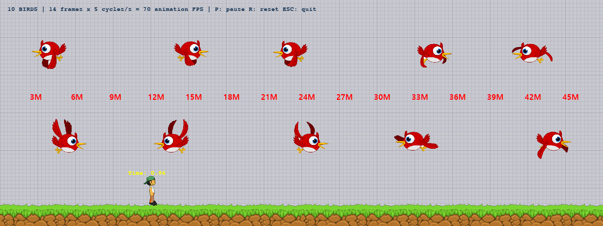

# DRILL 14 — 새의 비행 애니메이션

오늘 수업의 LEC16_Time 화면과 코드를 기반으로, 캐릭터 위쪽에 새 10마리를 추가했습니다. 격자 배경·잔디·거리 눈금·캐릭터·Time 표시와 기존 이동/발사를 유지합니다.



## 실행
Python 3.12 환경에서 의존성을 설치하고 main.py를 실행합니다.

```powershell
python -m pip install -r requirements.txt
python main.py
```

VS Code에서는 이 과제 폴더를 열고 `DRILL 14: 새 10마리` 실행 구성을 선택한 뒤 F5로 실행합니다. 모든 리소스는 코드 파일이 위치한 프로젝트 폴더를 기준으로 찾으므로 작업 디렉터리가 달라도 실행할 수 있습니다.

## 정확한 날갯짓 계산
- bird_animation.png의 전체 순서 14장 = 날갯짓 1회.
- 위에서 아래로, 각 행의 왼쪽부터 5장 + 5장 + 4장을 읽고 마지막 빈 칸은 제외합니다.
- 초당 5회이므로 `14 × 5 = 70` 애니메이션 프레임/초입니다.
- 한 주기는 `1 / 5 = 0.2초`, 프레임당 시간은 `1 / 70 ≈ 0.0142857초`입니다.
- `elapsed += frame_time`으로 누적하고 `floor(elapsed × 70 + 초기위상 × 14) % 14`로 표시할 프레임을 구합니다. 코드에는 부동소수점 경계 오차만 보정하는 1e-9를 더합니다.
- 새마다 초기 위상을 다르게 주어 자세는 달라도 날갯짓 빈도는 모두 초당 5회입니다.
- 게임 루프마다 1프레임씩 증가시키지 않습니다. 게임 FPS가 달라도 동일한 경과 시간에서 동일한 주기가 유지됩니다. 낮은 렌더링 FPS에서는 일부 그림이 건너뛰어질 수 있지만 시뮬레이션의 주기와 속도는 유지됩니다.
- 원본 새의 날개가 인접 칸으로 뻗는 부분은 실제 프레임 영역과 격자 중심 오프셋을 따로 정의해 처리합니다. 원본 이미지를 수정하지 않았습니다.

## 조작
| 키 | 동작 |
|---|---|
| 좌우 방향키 | 수업 캐릭터 이동 |
| Space | 공 발사; 수면 중에는 먼저 깨우기 |
| P | 전체 일시중지 / 재개 |
| R | 캐릭터와 새 10마리 초기화 |
| ESC 또는 창 X | 종료 |

## 수업 코드와의 관계
- main.py → game_framework.run(play_mode) → game_world.update/render 구조를 유지합니다.
- game_world.py는 수업의 객체 등록·갱신·그리기·정리 구조를 사용합니다.
- Boy/Grass/Ball과 그림·눈금·폰트는 수업 자료에서 가져왔습니다. 파일 위치와 관계없이 실행되도록 리소스 경로를 프로젝트 기준으로 보정했습니다.
- Bird.update()도 수업에서 배운 game_framework.frame_time을 사용합니다.
- 추가 변경: 단조 증가하는 perf_counter로 시간 측정, 0 나눗셈 방지, 종료 직후 불필요한 업데이트 방지, 렌더 루프 120FPS 상한, 자원 정리.
- CLASSROOM_BASE.md에 수업 원본의 출처와 SHA-256을 기록했습니다. 수업 원본 파일 자체는 변경하지 않았습니다.

## 파일
- PRD.md: 요구사항과 개발 단계.
- bird.py / animation.py / sprite_sheet.py: 새·시간 계산·원본 프레임 영역.
- play_mode.py / game_world.py / game_framework.py: 수업 기반 게임 흐름.
- boy.py / grass.py / ball.py: 기존 수업 화면과 캐릭터 동작.
- resources.py: 프로젝트 기준 리소스 경로.
- tests/: 시간 모델·비행·실제 게임 흐름 검증.
- VERIFICATION.md: 검증 결과와 범위.
- SUBMISSION_NOTES.md: e-Class 제출란에 직접 적을 문구.

## 검증
```powershell
python -B -m unittest discover -s tests -v
```

16개 테스트를 일반 실행과 VS Code debugpy에서 확인했습니다. 실제 SDL 캔버스를 사용하는 테스트가 있어 그래픽 환경이 필요합니다. 20/30/60/120/144 FPS에서 10초 후 50주기와 같은 프레임·이동 결과를 검증했습니다.

## 제출
https://github.com/kimminseoung-source/2D_DRILL_14.git

최종 커밋 본문에 날갯짓 계산과 수업 코드 연결 논리를 상세히 남겼습니다. 구조를 유지한 ZIP은 별도로 제공합니다. GitHub 업로드와 e-Class 제출은 별도이며, e-Class 제출 완료나 마감 준수는 확인되지 않았습니다.
